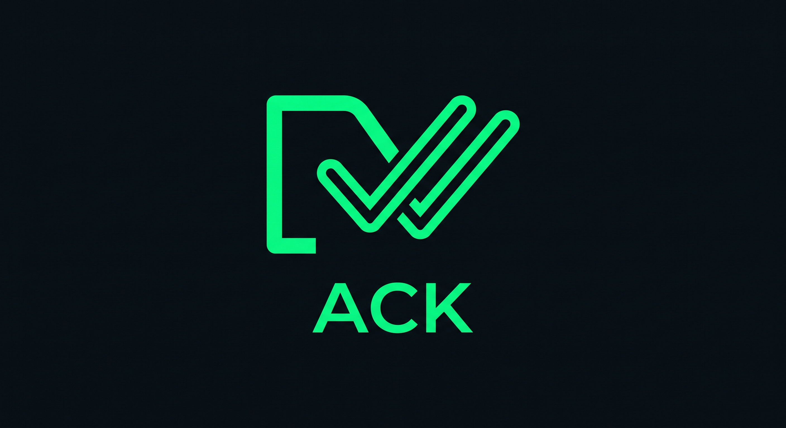

<p align="center">
  
</p>

# Project ACK (The Developer Messenger)

<p align="center">
  <strong style="font-size: 1.25rem;">The High-Velocity, Zero-Friction Developer Messenger</strong><br>
  Built for Software Engineers, Indie Hackers, CS Students, and Distributed Tech Teams.
</p>

<p align="center">
  <a href="https://github.com/kingenious0/ProjectACK/stargazers"></a>
  <a href="https://github.com/kingenious0/ProjectACK/network/members"></a>
  
  
  
  <a href="https://paystack.shop/pay/project-ack"></a>
</p>

<p align="center">
  <a href="https://github.com/topics/developer-tools"></a>
  <a href="https://github.com/topics/react-native"></a>
  <a href="https://github.com/topics/sqlite"></a>
  <a href="https://github.com/topics/zero-trust"></a>
  <a href="https://github.com/topics/indiehackers"></a>
  <a href="https://github.com/topics/supabase"></a>
</p>

> 🌟 **Trending on GitHub:** If you like what we're building with **Project ACK**, drop a ⭐ **Star** on this repository! It fuels open-source development and pushes ACK into GitHub Trending lists worldwide.

---

## ⚡ Key Highlights & Superpowers

### 1. Code Sharing & Line-by-Line Review
- Dark-mode syntax block with line numbers.
- Auto-collapses blocks exceeding 15 lines with interactive toggle.
- **Tappable Line Numbers:** Tap any line number to open an inline review thread quoting that exact line.

### 2. Burn-After-Reading .env Vault
- Send sensitive environment variables, connection strings, and tokens securely.
- **Client-Side AES-GCM Encryption.**
- **Instant Burn:** Recipient tapping **"Copy All"** automatically masks the text with asterisks and triggers an immediate purge from local and cloud relays.
- Configurable countdown self-destruct timers (30s, 60s, 5m, 10m).

### 3. Repo-Linked Team Chat
- Link chat rooms and channels directly to GitHub repositories (`org/repo`).
- Auto-generates webhook listeners (`POST /api/hook/:chatId`).
- Interactive GitHub PR cards with direct action triggers (`[View PR]`, `[Trigger Rebuild]`).

### 4. Zero-Lag `op-sqlite` Synchronous Engine
- Synchronous C++ SQLite bindings via `@op-engineering/op-sqlite`.
- Handles 100,000+ cached messages with 60fps scrolling and zero frame drops on mobile.

### 5. Ephemeral Real-Time Relay
- Ephemeral WebSocket transport pipeline where cloud stores discard payloads as soon as the recipient device ACKs receipt.
- **Optimistic State Machine:** Instant display with pending clock (`⏱`) &rarr; single check (`✓`) &rarr; double gray ticks (`✓✓`) &rarr; Cyber-Emerald read ticks (`✓✓`).

---

## 🎨 Design System: Obsidian & Cyber-Emerald

To ensure complete uniqueness and avoid Play Store trademark concerns with generic messenger colors, ACK uses an ultra-sleek, developer-first theme:

- **Background (Canvas):** `#0B0F12` (Deep Obsidian / Void Black)
- **Surface / Cards / Input Bars:** `#131B22` (Dark Slate Gray)
- **Primary Accent:** `#00FF66` (Cyber Emerald / Terminal Green)
- **Secondary Accent:** `#FFB800` (Dev Gold / Amber for `.env` vaults & warnings)
- **Bubble Sent:** `#003B1F` with `#00FF66` border stroke
- **Bubble Received:** `#161B22` (Dark Slate)
- **Text Primary:** `#F0F6FC`
- **Text Muted / Timestamps:** `#8B949E`

---

## 🗄️ Local Database Schema

```sql
-- Users Table
CREATE TABLE IF NOT EXISTS users (
    id TEXT PRIMARY KEY,
    github_username TEXT UNIQUE NOT NULL,
    phone_number TEXT UNIQUE,
    display_name TEXT NOT NULL,
    avatar_url TEXT,
    status_message TEXT,
    last_seen TIMESTAMP,
    created_at TIMESTAMP DEFAULT CURRENT_TIMESTAMP
);

-- Chats Table
CREATE TABLE IF NOT EXISTS chats (
    id TEXT PRIMARY KEY,
    type TEXT CHECK(type IN ('dm', 'group', 'channel', 'webhook')) NOT NULL,
    title TEXT,
    avatar_url TEXT,
    repo_webhook_secret TEXT,
    created_at TIMESTAMP DEFAULT CURRENT_TIMESTAMP,
    updated_at TIMESTAMP DEFAULT CURRENT_TIMESTAMP
);

-- Chat Participants Junction Table
CREATE TABLE IF NOT EXISTS chat_members (
    chat_id TEXT NOT NULL,
    user_id TEXT NOT NULL,
    role TEXT CHECK(role IN ('admin', 'member')) DEFAULT 'member',
    PRIMARY KEY (chat_id, user_id),
    FOREIGN KEY (chat_id) REFERENCES chats(id) ON DELETE CASCADE,
    FOREIGN KEY (user_id) REFERENCES users(id) ON DELETE CASCADE
);

-- Messages Table
CREATE TABLE IF NOT EXISTS messages (
    id TEXT PRIMARY KEY,
    chat_id TEXT NOT NULL,
    sender_id TEXT NOT NULL,
    content TEXT NOT NULL,
    message_type TEXT CHECK(message_type IN ('text', 'code', 'env_secret', 'system', 'media')) DEFAULT 'text',
    status TEXT CHECK(status IN ('pending', 'sent', 'delivered', 'read')) DEFAULT 'pending',
    quoted_message_id TEXT,
    metadata TEXT,
    created_at TIMESTAMP DEFAULT CURRENT_TIMESTAMP,
    FOREIGN KEY (chat_id) REFERENCES chats(id) ON DELETE CASCADE,
    FOREIGN KEY (sender_id) REFERENCES users(id),
    FOREIGN KEY (quoted_message_id) REFERENCES messages(id) ON DELETE SET NULL
);

-- Dev Status Table (24h Ship Logs)
CREATE TABLE IF NOT EXISTS status_posts (
    id TEXT PRIMARY KEY,
    user_id TEXT NOT NULL,
    media_url TEXT,
    caption TEXT,
    preview_url TEXT,
    expires_at TIMESTAMP NOT NULL,
    created_at TIMESTAMP DEFAULT CURRENT_TIMESTAMP,
    FOREIGN KEY (user_id) REFERENCES users(id) ON DELETE CASCADE
);
```

---

## 🚀 Quick Start

### 1. Install Dependencies
```bash
npm install
```

### 2. Run Typechecks & Tests
```bash
npx tsc --noEmit
npm test
```

### 3. Run Android Build
```bash
npx react-native run-android
```

---

## 💖 Support & Sponsorship

Project ACK is an open-source, developer-first communication tool. If you'd like to support active development, infrastructure, and Play Store releases:

👉 **[Sponsor Project ACK via Paystack (https://paystack.shop/pay/project-ack)](https://paystack.shop/pay/project-ack)**

---

## 🗺️ Roadmap & Phases

- [x] **Phase 1: Core Foundation & op-sqlite DDL**
  - Bare React Native CLI setup with Android Gradle structure
  - Synchronous C++ `op-sqlite` engine and DDL schema execution
  - Obsidian (`#0B0F12`) & Cyber-Emerald (`#00FF66`) 4-tab bottom navigation
  - Code block reviewer with line-by-line thread quoting
  - Burn-After-Reading `.env` vault with instant masking on copy
  - Interactive GitHub repo card with CI/CD rebuild action
- [ ] **Phase 2: Authentication & Contact Discovery**
  - Supabase Auth integration with GitHub OAuth
  - Phone number hashing and local contact synchronization
- [ ] **Phase 3: Supabase Realtime Ephemeral Relay**
  - WebSocket broadcast with immediate zero-retention ACK receipt purge
- [ ] **Phase 4: Play Store Production APK**
  - Release keystore signing, Gradle production bundle, and Play Store publishing

---

## 🏷️ Trending Topics & Discovery Tags

`#developer-tools` `#react-native` `#op-sqlite` `#zero-trust` `#encryption` `#cybersecurity` `#indiehackers` `#supabase` `#code-review` `#devtools` `#privacy` `#realtime` `#typescript` `#open-source` `#mobile-app` `#chat` `#messenger` `#android` `#github-actions` `#sqlite`

