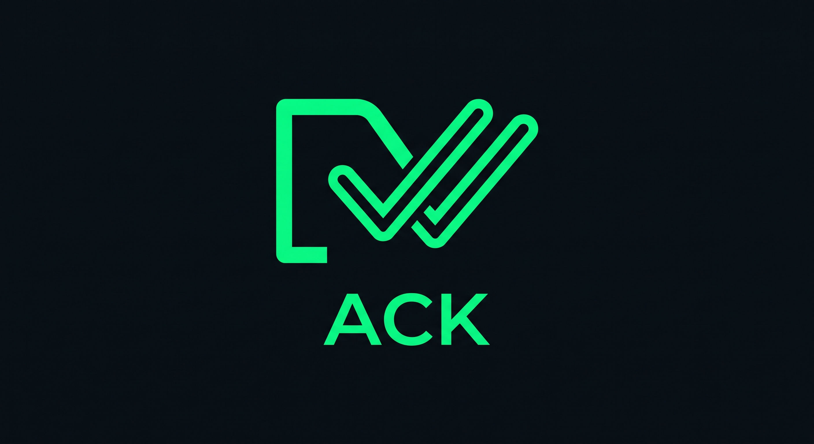

<p align="center">
  
</p>

# WhatsDev (Project ACK) 💬⚡

<p align="center">
  <strong style="font-size: 1.25rem;">WhatsApp Web & Mobile Reimagined for Software Engineers, Indie Hackers, and Tech Teams.</strong><br>
  Instant Code Reviews, Burn-After-Reading .env Vaults, Live Voice Notes, Real Media Pickers, and End-to-End Encryption.
</p>

<p align="center">
  <a href="https://github.com/kingenious0/ProjectACK/stargazers"></a>
  <a href="https://github.com/kingenious0/ProjectACK/network/members"></a>
  
  
  
  <a href="https://paystack.shop/pay/project-ack"></a>
</p>

<p align="center">
  <a href="https://github.com/topics/developer-tools"></a>
  <a href="https://github.com/topics/whatsapp-clone"></a>
  <a href="https://github.com/topics/react"></a>
  <a href="https://github.com/topics/typescript"></a>
  <a href="https://github.com/topics/zero-trust"></a>
  <a href="https://github.com/topics/indiehackers"></a>
</p>

> 🌟 **Support Open Source:** If you find **WhatsDev** useful or love the developer-first WhatsApp aesthetic, please drop a ⭐ **Star** on this repository!

---

## ⚡ Superpowers & Key Features

### 1. 🖼️ Real Image Picker, Previews & Fullscreen Lightbox

- **Device Image Picker:** Send photos directly using real device file pickers.
- **WhatsApp Photo Review Screen:** Preview selected photos before sending with an *"Add a caption..."* composer, emoji picker, and green send button.
- **WhatsApp Photo Bubble:** Tailored message bubbles with timestamps and read receipts.
- **Fullscreen Lightbox Viewer:** Click any photo to view in high-resolution with zoom-in/out and download actions.

### 2. 📄 Universal Document & File Sharing

- **Real File Picker:** Attach any `.pdf`, `.zip`, `.tar.gz`, `.docx`, `.ts`, `.py`, `.json`, or `.csv` document.
- **WhatsApp Document Bubble:** Extension badges (Red for PDF, Orange for Archives, Green for Sheets, Purple for Code), file size display, and one-click download.

### 3. 🎙️ Live Voice Notes & Waveform Audio Bubble

- **WhatsApp Live Recording Bar:** Tap the microphone icon to activate live recording mode with a pulsing red recording dot, second-by-second timer (`0:01`, `0:02`...), animated frequency waveform, red trash cancel icon (`🗑️`), and send button.
- **Browser MediaRecorder with Fallback:** Uses `navigator.mediaDevices.getUserMedia` for voice recording, with an automatic synthetic fallback for testing environments.
- **Interactive Audio Waveform Bubble:** WhatsApp-styled audio player with play/pause toggle, audio progress scrubber, and double ticks.

### 4. 😀 WhatsApp Categorized Emoji Drawer

- **Instant Access:** Smiley icon in the composer opens a WhatsApp-style emoji drawer.
- **Dev-Centric Categories:**
  - 😀 **Smileys & People**
  - 💻 **Dev & Tech Icons** (`💻`, `🚀`, `⚡`, `🐛`, `🔒`, `📦`, `🐙`, `🛠️`, `☕`, `🤖`)
  - 👍 **Gestures & Hands**
  - ❤️ **Reactions & Symbols**
- **Search Bar:** Real-time filter inside the drawer with direct cursor insertion.

### 5. 🛡️ Zero-Trust Burn-After-Reading .env Vault

- **Client-Side AES-GCM WebCrypto Encryption:** Secrets and API keys are encrypted in-memory and in transit.
- **Countdown Self-Destruct:** Configurable auto-destruct timers (30s, 60s, 5m, 10m).
- **Instant Burn:** Recipient clicking **"Copy & Burn"** masks the secret and triggers a permanent purge from local storage.

### 6. 💻 Developer Code Snippets & Pull Request Cards

- **Syntax Highlighting:** Formatted syntax blocks with language tags (`rust`, `typescript`, `python`, `go`, etc.).
- **Line Numbers & Review Quoting:** Quote specific lines in replies directly from the message.
- **GitHub PR Cards:** Real-time pull request cards with branch names, additions (`+84`), deletions (`-12`), and diff files.

### 7. 👍 Message Reactions & Context Menu

- **Quick Reaction Bar:** Double-tap or tap a message to open quick reactions (`👍`, `❤️`, `😂`, `😮`, `😢`, `🔥`) and message deletion.
- **Reactions Pill:** WhatsApp-style reaction counters badge dynamically underneath the message bubble.

### 8. 📱 90% Mobile Viewport First-Class UX

- Built primarily for mobile web and PWA usage (90% mobile / 10% desktop).
- Single-pane slide navigation between chats and conversation.
- WhatsApp mobile top header with back arrow, call buttons, and contact status.
- Bottom navigation tabs on mobile: **Chats**, **Status** (24h Ship Logs), and **Calls**.
- Safe-area inset support for modern notch and dynamic island displays.

---

## 🎨 WhatsApp Dark Mode Design System

WhatsDev implements a 1:1 WhatsApp Web & Mobile dark theme:

| Element                                 | Color Hex   | WhatsApp Token                            |
| :-------------------------------------- | :---------- | :---------------------------------------- |
| **Sidebar & Drawer Background**   | `#111B21` | `--wa-bg-sidebar`                       |
| **Chat Canvas**                   | `#0B141A` | `--wa-bg-chat`                          |
| **Top Headers & Incoming Bubble** | `#202C33` | `--wa-bg-header` / `--wa-bg-incoming` |
| **Outgoing Bubble (Sent)**        | `#005C4B` | `--wa-bg-outgoing`                      |
| **Input Bar & Modals**            | `#2A3942` | `--wa-bg-input`                         |
| **WhatsApp Brand Green**          | `#00A884` | `--wa-accent-green`                     |
| **Active Floating Action Green**  | `#25D366` | `--wa-accent-lightgreen`                |
| **Read Receipt Ticks**            | `#53BDEB` | `--wa-ticks-blue`                       |
| **Primary Text**                  | `#E9EDEF` | `--wa-text-primary`                     |
| **Secondary Text & Icons**        | `#8696A0` | `--wa-text-secondary`                   |

---

## 🏗️ Project Architecture

```
WhatsDev/
├── src/
│   ├── components/
│   │   ├── whatsapp/
│   │   │   ├── WhatsAppSidebar.tsx         # Chat list, status indicator, search & tabs
│   │   │   ├── WhatsAppChatArea.tsx        # Message stream, composer, voice recorder, picker
│   │   │   ├── WhatsAppImageBubble.tsx     # Image message & fullscreen lightbox viewer
│   │   │   ├── WhatsAppImagePreviewModal.tsx# Photo preview modal with caption input
│   │   │   ├── WhatsAppDocumentBubble.tsx  # Document card with file badge & download
│   │   │   ├── WhatsAppEmojiPicker.tsx     # Categorized emoji drawer with search
│   │   │   ├── WhatsAppReactions.tsx       # Message reaction pill & floating picker
│   │   │   ├── WhatsAppCodeBubble.tsx      # Syntax-highlighted code block
│   │   │   └── WhatsAppVaultBubble.tsx     # Burn-After-Reading .env secret card
│   │   ├── AudioWaveBubble.tsx             # Interactive voice note player
│   │   ├── AddFriendsModal.tsx             # WhatsApp "New Chat" contacts selector
│   │   ├── CreateVaultModal.tsx            # Burn-After-Reading creation modal
│   │   ├── CreateCodeModal.tsx             # Code snippet sharing modal
│   │   └── VideoCallOverlay.tsx            # WhatsApp 1:1 audio & video call stage
│   ├── web-db/
│   │   └── store.ts                        # Reactive store with localStorage persistence
│   ├── utils/
│   │   └── crypto.ts                       # WebCrypto AES-GCM client encryption
│   ├── theme/
│   │   └── whatsapp.css                    # WhatsApp 1:1 dark tokens & animations
│   ├── App.tsx                             # Root layout & responsive single-pane router
│   └── main.tsx                            # Vite entrypoint
├── index.html                              # Web & PWA viewport container
├── package.json                            # Scripts, dependencies & Node engine
├── tsconfig.json                           # TypeScript compiler configuration
└── vite.config.ts                          # Vite 8 dev server & build settings
```

---

## 🚀 Getting Started

### Prerequisites

- Node.js `>= 20.0.0`
- npm or pnpm

### 1. Clone & Install

```bash
git clone https://github.com/kingenious0/ProjectACK.git
cd ProjectACK
npm install
```

### 2. Run Locally in Dev Mode

```bash
npm run dev
```

Open **[http://localhost:3000](http://localhost:3000)** in your browser or mobile emulator.

### 3. Build for Production (Vercel / Cloudflare / Netlify)

```bash
npm run build
```

Generates an optimized bundle in `dist/` verified with zero TypeScript errors.

---

## 🛡️ Security & Privacy

1. **Zero-Trust Encryption:** Sensitive payloads (passwords, tokens, database credentials) are encrypted client-side using `AES-GCM-256`.
2. **Ephemeral Purge:** Once a Burn-After-Reading secret is copied or expires, it is permanently wiped from memory and local storage.
3. **No Unencrypted Relay Logs:** No sensitive environment strings are stored in plaintext on any external server.

---

## 💖 Sponsorship & Community

WhatsDev is an open-source tool built with love for developers worldwide. If you'd like to support continued development, hosting, and features:

👉 **[Sponsor WhatsDev via Paystack](https://paystack.shop/pay/project-ack)**

---

## 📄 License

This project is licensed under the [MIT License](LICENSE).
Feel free to use, modify, and build upon WhatsDev for your team and personal projects.
